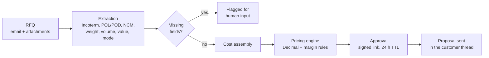
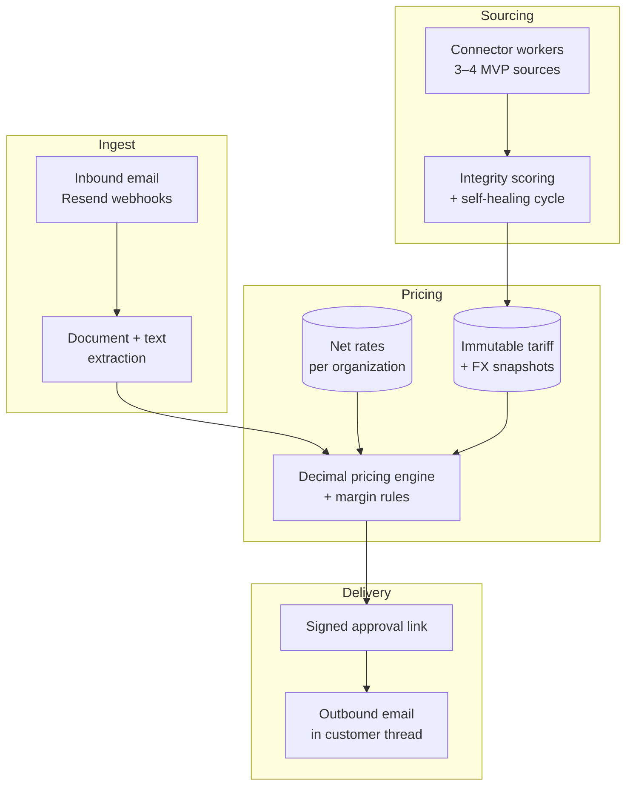

# QuotePilot

**Autonomous freight pricing for foreign trade.**

The RFQ lands in your inbox. The quote leaves in minutes, with the math behind it.

---

## What it is

QuotePilot is a pricing copilot for freight forwarders and NVOCCs. It sits on the quote inbox, turns an unstructured RFQ into a structured shipment, prices it against your negotiated rates plus today's public terminal tariffs and carrier FX, and returns a proposal with a line-by-line audit trail for a one-click approval.

It is not a spreadsheet with an AI autocomplete bolted on. The extraction step is probabilistic and is allowed to be; the pricing step is deterministic, runs in `Decimal`, and every number in the final PDF can be traced back to the rate row, tariff snapshot and FX quote that produced it.

## The problem

A quote request arrives as free text with a PDF attached and half the fields missing. To answer it with a margin, an analyst opens the carrier portal, the terminal tariff table, the surcharge notice and the FX page — for a single shipment.

| | Today |
|---|---|
| **Slow quotes** | 24–48 h to respond. The shipper books with whoever answered first. |
| **Stale tariffs** | An expired rate table gets used and the quote ships with negative margin. |
| **Wrong FX** | PTAX is not the carrier's dollar. The spread eats the margin at booking. |
| **Manual rework** | 2–4 h retyping the same request into a spreadsheet, with no comparable history. |

## How it works

1. **The RFQ arrives.** Each company has its own quote address and its own inbox. Nothing is shared between tenants.
2. **The agent extracts.** Incoterm, POL/POD, NCM, weight, volume, cargo value and mode come out of the body text and the attachments, with a per-field confidence score. What it could not read is marked, never guessed.
3. **Costs are assembled.** Your negotiated net rates (scoped to the company), public terminal tariffs, surcharges and the carrier's dollar for the day.
4. **The engine prices it.** Ocean/air freight, local charges, AFRMM, IOF, insurance and margin — computed in `Decimal`, with a line-by-line calculation memo.
5. **Someone approves.** Inferred items are highlighted. On approval the proposal goes out in the customer's original thread, under your branding.

## Core capabilities

**RFQ inbox** — every request in one queue with status, extraction confidence, estimated value and SLA-at-risk flagging, so the analyst knows where to step in before the deadline breaks.

**Rate tables and rules** — net rates uploaded as CSV or PDF with validity windows, target margin, FX spread, per-route floors, and a hard block on quoting negative margin. An expired table is surfaced before it can reach a calculation.

**Pricing engine** — deterministic money math in `Decimal`, an immutable snapshot referenced by every quote, and recalculation when FX moves inside the validity window.

**Connector console** — the public inputs that define your margin (FX, terminal tariffs, PTAX) monitored for latency, collection time and an integrity score. Each source keeps its own snapshot, so a rate change never rewrites history.

**Self-healing parsers** — terminal portals and FX pages change layout without notice. When a source's extraction score drops below threshold, a repair cycle opens on its own: failing parser reproduced, fix applied, tests run in isolation, and a pull request opened for human review. The team sees a reviewed diff, not a fire.

**One-click approval** — the approval email carries the quote summary, net margin, applied FX and validity, with inferred items marked. The link is single-use, signed and expires in 24 hours.

## Architecture

QuotePilot is multi-tenant by construction: the isolation lives in the database, not in the UI.

Every tenant-scoped domain table carries `organization_id` and is protected by PostgreSQL row-level security. Attachments and generated PDFs live under a per-tenant storage prefix and are reachable only through signed URLs issued after a permission check. AI context is recovered inside the requesting tenant's transaction — no memory is shared across executions.

**Stack.** A Go `core-api` owns ingestion, tenant-scoped database and storage access, deterministic decimal pricing, and River jobs. A stateless Python `ai-engine` handles extraction, public-source connectors, and rendering; React and TypeScript power the web frontend. PostgreSQL enforces row-level security: Railway hosts development Postgres with pgvector, and Supabase hosts production Postgres in `sa-east-1`. Cloudflare R2 stores private files in separate development and production buckets; Railway hosts the services, and Cloudflare Pages hosts the frontend. Resend handles inbound and outbound mail, Firecrawl collects selected public tariff sources, and Devin proposes connector repairs for human review. The public site and its lead API are delivered as a separate repository.

## Design principles

- **Auditable or it did not happen.** Every quote resolves to a rate row, a tariff snapshot and an FX quote, all immutable.
- **Probabilistic extraction, deterministic pricing.** The model reads; the engine computes. They are never the same step.
- **Money is never a float.** `Decimal` end to end, with the rounding rule stated per line.
- **Humans approve, machines prepare.** Confidence and ambiguity are surfaced, not smoothed over.
- **Fail loudly on the data, quietly on the plumbing.** A degraded source flags the quote; a mail provider hiccup does not lose the lead.

## Status

Early development. The repository contains the app and contract scaffolds, local PostgreSQL role checks, and architecture documentation; the application code is being prepared for publication. The MVP connector scope is three or four sources, pending pilot-company input (RFC-003).

The pilot runs with four freight forwarding companies on maritime and air imports through Santos, Itajaí, Paranaguá, GRU and Viracopos. Targets we hold ourselves to:

- less than 5 minutes from inbox to proposal (against a 24–48 h market baseline today)
- 100% of the calculation auditable, line by line
- zero cross-tenant leakage on any query path

## Team

Built by three people at [NewByte](https://github.com/NewByteGroup).

| | Role |
|---|---|
| **Marcelo** | Product owner, AI agent architecture, UI/UX |
| **Pedro** | Backend tech lead, multi-tenancy, pricing engine |
| **Amanda** | Frontend, automation, Devin operations |

## Contributing

The project is not accepting external contributions while the core is being prepared for release. Issues and questions about the product are welcome on the issue tracker.

## License

Apache License 2.0 — see [LICENSE](LICENSE).

---

**NewByte** · Hack Brasil 2026 · [contato@quotepilot.com.br](mailto:contato@quotepilot.com.br)

